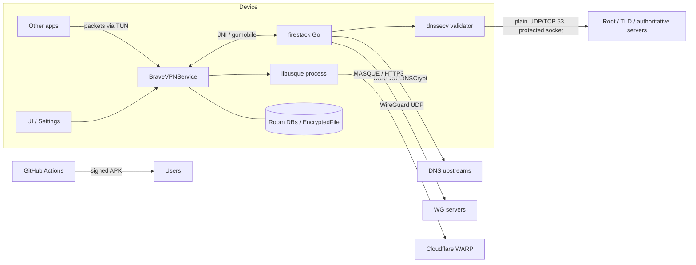

# Threat model

Living document. Update it in the same PR as any change that adds a network
path, permission, exported component, stored secret, or third-party code.

Method: **PASTA** gives the overall process (business goals → attacks →
risk), **STRIDE** enumerates threats per component, **DREAD** ranks them.
DREAD is subjective; treat scores as an ordering, not a measurement.

## 1. Objectives (PASTA stage 1)

AuroraVPN is a privacy tool. Its security goals, in priority order:

1. **No leaks:** user traffic and DNS must never bypass the chosen protection
   (tunnel, encrypted DNS, firewall rules) without the user knowing.
2. **Integrity of answers:** DNS answers and firewall decisions must not be
   forgeable by the network.
3. **Key secrecy:** WireGuard / WARP / proxy credentials never leave the
   device and are encrypted at rest.
4. **Availability:** a crash or bad input must not drop protection silently.
5. **Supply chain:** what users install is exactly what this repo built.

## 2. Technical scope (PASTA stage 2)

| Component | Tech | Notes |
|---|---|---|
| UI / settings | Kotlin, AndroidX, Room | single Activity stack, AppLock (biometric / device credential) |
| `BraveVPNService` | Kotlin `VpnService` | owns the TUN fd, protects sockets, network monitoring |
| firestack | Go via gomobile `.aar` | netstack (gVisor), DNS (DoH/DoT/DNSCrypt/ODoH), firewall hooks, WireGuard |
| **dnssecv** (new) | Go, in firestack `intra/` | local recursive DNSSEC validator; today drives the DNS-card self-test only |
| usque | Go executable `libusque.so` | WARP over MASQUE, launched as a child process; SHA-256 pinned at build |
| Storage | Room DBs, `EncryptedFile` (Keystore) | WireGuard configs encrypted; logs in SQLite |
| Build & release | GitHub Actions, Gradle, F-Droid recipe | signing key in Actions secrets |
| Website | GitHub Pages | serves APK links and QR code |

## 3. Decomposition and trust boundaries (PASTA stage 3)

Trust boundaries: **TB1** other apps ↔ TUN; **TB2** Kotlin ↔ Go (JNI);
**TB3** device ↔ network (every arrow leaving Device); **TB4** app ↔ child
process (usque); **TB5** repo/CI ↔ users' devices.

## 4. STRIDE per component (PASTA stages 4–5)

| # | Component | STRIDE | Threat | Existing control | Gap / action |
|---|---|---|---|---|---|
| T1 | TUN / VPN service | **D**, **I** | Go panic in netstack kills the service; traffic leaks until restart (VULN-A) | auto-restart | recover() in goroutines; document "Always-on + Block connections without VPN" in onboarding |
| T2 | Firewall | **E** | `BYPASS_DNS_FIREWALL` granted via social engineering (VULN-F) | audit log line | surface grants in UI, not just logs |
| T3 | Firewall | **S** | UID reuse inherits old app's rules (VULN-C) | tombstone purge | regression test |
| T4 | DNS upstreams | **T**, **I** | On-path attacker forges DNS when upstream is plain DNS53 | DoH/DoT/DNSCrypt available | default to encrypted upstream; warn on plain DNS |
| T5 | DNS upstreams | **T** | Malicious or compromised DoH resolver returns forged answers | none (resolver is trusted) | **dnssecv per-query validation (phase 2)** |
| T6 | dnssecv | **T** | Validator bug accepts forged data (library is alpha) | fail-closed wrapper, `Broken` self-test state, unit tests | live self-test in CI; re-vendor checklist (PATCHES.md) |
| T7 | dnssecv | **I** | Recursive queries go out in plaintext from the real IP, outside DoH/WARP; on-path observers see probe names | only fixed probe zones are queried; sockets protected | phase 2 must use a *validating stub over the encrypted upstream* instead of recursion for user lookups |
| T8 | dnssecv | **D** | Network blocks port 53 (hotel, corporate) → no verdict | `Unreachable` state, never shown green | none |
| T9 | dnssecv | **D** | Attacker-controlled zone causes deep delegation / CNAME loops, amplifying traffic | 100-query cap, 6 s budget, 8 concurrent max, input allowlist | none |
| T10 | dnssecv | **T** | Clock wrong → valid signatures look expired → everything Bogus | `Degraded` state | show "check device time" hint when all probes Bogus |
| T11 | dnssecv | **T** | Root KSK rollover not reflected in embedded anchors | KSK-2017 + KSK-2024 embedded | yearly anchor check (PATCHES.md step 5) |
| T12 | Kotlin ↔ Go | **D**, **T** | Use-after-free / double-free at tunnel teardown across JNI (VULN-E) | — | upstream firestack work |
| T13 | Storage | **I** | PCAP or logs written to shared storage (VULN-H) | path canonicalisation | — |
| T14 | Storage | **I** | WireGuard keys extracted from backup | `allowBackup=false`, EncryptedFile | — |
| T15 | UI | **T** | HTML injection via DNS/blocklist strings rendered with `Html.fromHtml` | values now escaped with `TextUtils.htmlEncode` | Semgrep `aurora-html-from-untrusted` |
| T16 | usque | **T**, **E** | Tampered `libusque.so` | SHA-256 pin checked at build | verify pin at runtime before exec |
| T17 | Wi-Fi rules | **S** | Evil-twin SSID pauses tunnel (VULN-G) | BSSID TOFU pin | — |
| T18 | CI / release | **T**, **E** | Compromised Action or dependency injects code | actions pinned to SHAs, Dependabot, dependency review | SLSA provenance for APKs; reproducible build check |
| T19 | CI / release | **I** | Release keystore exposed (generated in CI; artifact + logs readable by repo readers) | instructions to delete the run | generate offline with `keytool`, remove `generate-keystore.yml` |
| T20 | Website | **T** | APK link or QR swapped to a malicious build | GitHub Pages over HTTPS | publish SHA-256 next to each download; ZAP monthly |
| T21 | Exported components | **E** | Other apps start activities/services with crafted intents | 2 exported components | MobSF review each release; validate all intent extras |
| T22 | Logging | **I** | Tokens or keys in logcat / bug reports | Semgrep `aurora-log-sensitive` | — |

STRIDE key: **S**poofing, **T**ampering, **R**epudiation, **I**nformation
disclosure, **D**enial of service, **E**levation of privilege.

## 5. DREAD ranking (PASTA stage 6–7: risk and countermeasures)

Scores 1–10: Damage, Reproducibility, Exploitability, Affected users,
Discoverability. Risk = mean.

| Threat | D | R | E | A | D | Risk | Decision |
|---|---|---|---|---|---|---|---|
| T19 release key exposure | 10 | 8 | 6 | 10 | 5 | **7.8** | Fix now: rotate if the run ever existed publicly; move key generation offline |
| T1 panic → leak | 8 | 6 | 5 | 9 | 5 | **6.6** | Upstream fix; onboarding nudge to lockdown mode |
| T5 malicious DoH resolver | 8 | 9 | 4 | 6 | 5 | **6.4** | dnssecv phase 2 |
| T18 supply chain | 10 | 3 | 3 | 10 | 4 | **6.0** | Provenance + reproducible builds |
| T6 validator accepts forgery | 8 | 4 | 3 | 7 | 4 | **5.2** | Accept with controls; live CI self-test |
| T7 plaintext recursion | 5 | 10 | 8 | 3 | 6 | **6.4** for user lookups, **2.0** for probes only | Probes only until phase 2 design |
| T20 swapped download | 9 | 3 | 3 | 6 | 3 | **4.8** | Publish hashes |
| T15 HTML injection | 3 | 5 | 4 | 4 | 4 | **4.0** | Fixed; rule in CI |

## 6. DNSSEC phase 2 (design note)

Recursive validation from the root (what dnssecv does today) is the
strongest *integrity* guarantee but leaks every queried name to the network
in plaintext (T7). For user lookups, the preferred design is a **validating
stub resolver** (RFC 4035 §4.9): send queries with the DO bit through the
user's encrypted upstream, fetch DS/DNSKEY through the same upstream, and
verify locally with the `dnssec` package already vendored. This keeps DoH
privacy and removes trust in the resolver. Recursion stays available as an
opt-in "maximum integrity" mode with a clear privacy warning.

Fail policy for phase 2: `Bogus` → answer SERVFAIL (never forward forged
data); `Unknown` → forward with a log entry, configurable to SERVFAIL in a
"strict" mode.
